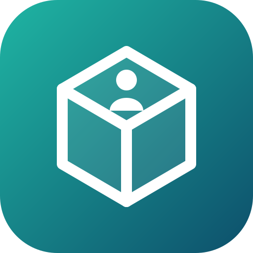
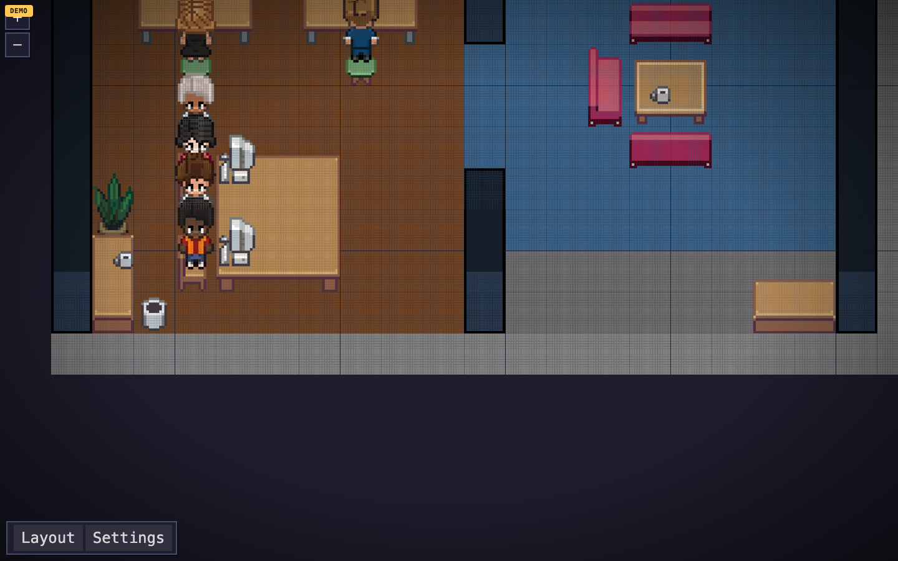
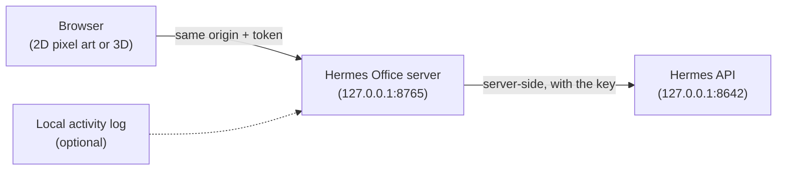
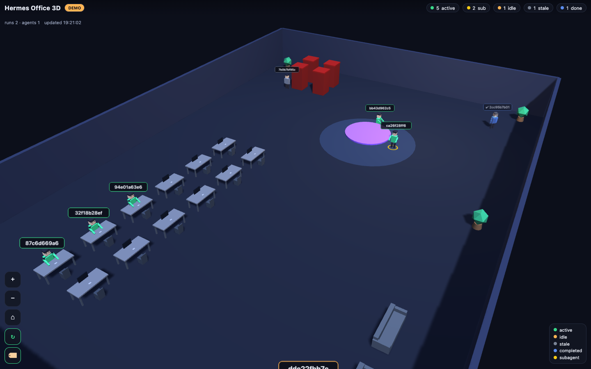
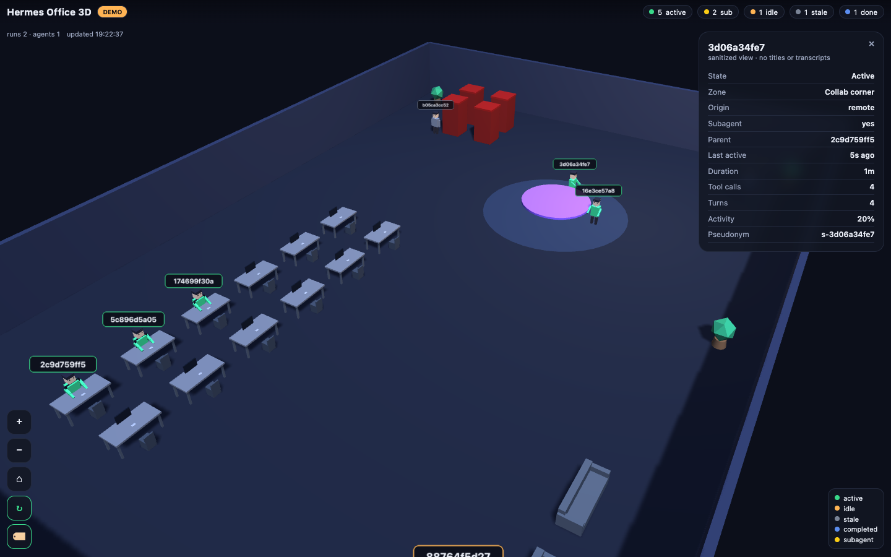
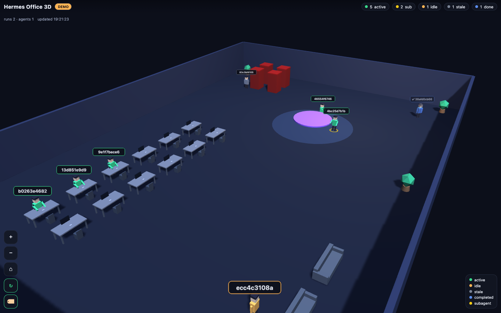
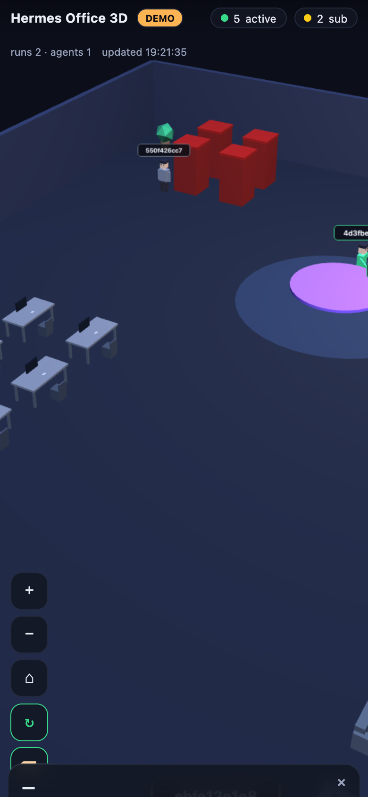

<div align="center">

[](README.md)



# Hermes Office 3D

**An animated office that shows your running Hermes Agent sessions.**<br>
One character per recent session, subagents included. Read-only and private by default: the browser never sees your titles, prompts or key.

[](LICENSE)
[](pyproject.toml)
[](#screenshots)
[](docs/MOBILE_ACCESS.md)
[](SECURITY.md)

</div>

<p align="center"></p>

<p align="center"><sub>Screenshot rendered by the demo mode (synthetic data). No real session appears.</sub></p>

## Why

When several Hermes agents run at once, it is hard to see at a glance who is working, who is waiting and who spawned subagents. Hermes Office 3D puts it all in an office: one character per recent session, placed according to its state.

It is a monitor, not yet another dashboard: it cannot send messages, run tools or stop runs. It reads the local Hermes API server-side and hands the browser only an anonymised snapshot.

> **This GitHub repository is source only.** Cloning it does not publish your office. What runs is a local, token-guarded server on `127.0.0.1` that you start yourself.

## How it works



- **One counterpart for the browser.** It only talks to the office server. The Hermes API key stays in the server process.
- **Nothing made up.** Every character is a real row of `GET /api/sessions`. If the API is configured but unreachable, the UI says so and shows nothing.
- **Two views.** The root opens the 2D pixel-art office ([Pixel Agents](NOTICE.md)). The older low-poly 3D view stays at `/office.html`, after sign-in.
- **Demo mode.** With no key, or with `--demo`, the server serves synthetic characters (ids start with `demo-`), never mixed with real ones.

### What one character means

A character is a **recent, real row** from `GET /api/sessions`. In live mode, old or completed sessions do not appear. A recent row does not prove the session is running:

| Shown | Source field | Notes |
| --- | --- | --- |
| one character per recent session | `id` | the id is pseudonymised server-side; the UI shows names such as `Session 1` |
| `recently active` / `quiet` | `last_active`, `ended_at` | derived from recency only, not live run status |
| `completed` | `ended_at` present | never rendered in the active office |
| subagent ring + parent link | `parent_session_id`, `is_internal_child` | child sessions, requested with `include_children=true` |
| tool calls / turns | `tool_call_count`, `message_count` | plain cumulative counts |
| origin | `source` | bucketed to `local` / `remote` / `agent` |

Zone placement (`Workstation`, `Collab corner`, `Lounge`, `Quiet booth`, `Archive`) is a presentation choice tied to state, never a fact about what a session is doing.

| State | Condition |
| --- | --- |
| `active` | not ended and `now - last_active ≤ ACTIVE_SECONDS` (default 120 s) |
| `idle` | not ended and `now - last_active ≤ IDLE_SECONDS` (default 300 s) |
| `stale` | not ended and older than `IDLE_SECONDS`: hidden |
| `completed` | `ended_at` is set: hidden |

Labels (`Session 1`, `Subagent 1`) are local aliases, stable across refreshes, not session names or opaque hashes.

### Running versus recently active

Hermes' session-list API does not expose a per-session running status. The global counters (`active_agents`, `active_runs`) say work is in flight, but not which session it belongs to. A long, silent tool can have an old last-activity timestamp. Hermes Office therefore shows recent activity only, never presents it as confirmed work, and shows the aggregate counters separately. If no recent session can be identified, the office stays empty, even when the gateway reports work in progress.

**Real run activity (optional, off by default).** If you set `HERMES_OFFICE_RUN_ACTIVITY_LOG` to a local log written by the A2A bridge, the server reads its tail, looks the runs up, and marks a session `working` only when the Hermes Runs API confirms a run in progress for it. With `HERMES_API_KEY` set, it then follows those runs' tool events and animates the character by a coarse category (`code`, `search`, `terminal`, `review`, `other`). Tool names, arguments, results and ids never leave the server. It only covers runs that went through that bridge, not every conversation.

## Install

```sh
curl -fsSL https://raw.githubusercontent.com/pyxl-dev/hermes-office-3d/main/install.sh | sh
```

The installer puts the code in `~/.local/share/hermes-office-3d` and adds the `hermes-office-3d` command to `~/.local/bin`. Run it again to update; `--uninstall` removes it (the `~/.hermes-office-token` file stays, delete it yourself if you want). It only touches your home folder.

Then the demo mode, no secrets and no Hermes needed:

```sh
hermes-office-3d --demo
```

Open the printed URL and sign in with the token written to `~/.hermes-office-token` (a random one is generated on first run, mode `0600`, and never printed).

Without the installer:

```sh
git clone https://github.com/pyxl-dev/hermes-office-3d.git
cd hermes-office-3d
python3 -m hermes_office --demo
```

### Live mode (your real sessions)

From the code folder (`~/.local/share/hermes-office-3d` with the installer, or your clone):

```sh
cp .env.example .env
# edit .env and set:
#   HERMES_OFFICE_TOKEN=<a long random string>
#   HERMES_API_KEY=<your Hermes API_SERVER_KEY>
# (the key lives in ~/.hermes/.env as API_SERVER_KEY: copy it, don't commit it)
make run          # or: python3 -m hermes_office
```

The server reads a local `.env` automatically; real environment variables always win. Otherwise export them in your shell:

```sh
set -a; source .env; set +a
python3 -m hermes_office
```

Open `http://127.0.0.1:8765`, sign in with your token, and your live office appears. With the installer, `hermes-office-3d` runs the same thing from its install folder, so it reads the `.env` there.

### Let your AI agent do it

Paste this into Claude Code, Codex, Cursor or any agent with a shell:

```text
Install and run Hermes Office 3D: https://github.com/pyxl-dev/hermes-office-3d
Follow the AGENTS.md in that repository.
```

[`AGENTS.md`](AGENTS.md) tells the agent how to install it, how to run it and the safety rules (never expose the Hermes API, never print the token).

### Requirements

| | Needed for |
| --- | --- |
| macOS or Linux | everything |
| Python 3.9 or newer | the server (standard library only, nothing to `pip install`) |
| git | the installer |
| A local Hermes API and its key | live mode; without it, demo mode |
| [Tailscale](https://tailscale.com) on the machine and the phone | viewing the office from the phone (optional) |

## Usage

```sh
hermes-office-3d [--host HOST] [--port N] [--demo] [--verbose]
```

| Option | Default | |
| --- | --- | --- |
| `--host HOST` | `127.0.0.1` | bind address |
| `--port N` | `8765` | bind port |
| `--demo` | off | force synthetic data, even with a key |
| `--verbose` | off | debug logging |

All configuration is environment variables (see [`.env.example`](.env.example)). No personal value is hard-coded.

| Variable | Default | |
| --- | --- | --- |
| `HERMES_OFFICE_HOST`, `HERMES_OFFICE_PORT` | `127.0.0.1`, `8765` | where the server listens |
| `HERMES_OFFICE_ALLOW_REMOTE` | `0` | a non-loopback bind is refused unless `1`; only do it behind authenticated access |
| `HERMES_OFFICE_TOKEN` | generated | token guarding every route (letters, digits, `-_.`) |
| `HERMES_API_BASE` | `http://127.0.0.1:8642` | local Hermes API |
| `HERMES_API_KEY` | empty | the `API_SERVER_KEY`; empty = demo mode |
| `HERMES_OFFICE_POLL_SECONDS` | `4` | refresh rate |
| `HERMES_OFFICE_ACTIVE_SECONDS`, `HERMES_OFFICE_IDLE_SECONDS` | `120`, `300` | recency thresholds |
| `HERMES_OFFICE_MAX_ACTORS` | `48` | maximum number of characters |
| `HERMES_OFFICE_RUN_ACTIVITY_LOG` | empty | local activity log (optional observation) |

### View the office on your phone

Remote access is off by default. The recommended path is `tailscale serve`, which publishes only this port to your private Tailscale network:

```sh
tailscale serve --bg --https=443 http://127.0.0.1:8765
```

Open `https://<machine>.<your-tailnet>.ts.net/` on the phone and sign in with the token. Details, checks and alternatives in [`docs/MOBILE_ACCESS.md`](docs/MOBILE_ACCESS.md). Never expose `127.0.0.1:8642`, and never expose the office without its token.

## Security

Read [`SECURITY.md`](SECURITY.md) and [`docs/PRIVACY.md`](docs/PRIVACY.md). In short:

- binds to `127.0.0.1` by default, never a public interface;
- **every** route (UI, `/api/office`, `/events`) needs a token or an `HttpOnly; SameSite=Strict` cookie: there is no anonymous office;
- the browser never reaches the Hermes API, the key stays server-side;
- strict CSP, `X-Frame-Options: DENY`, `nosniff`, no CORS;
- the payload is built from a strict allow-list and ids are pseudonymised with a per-run salt.

Never sent to the browser: `title`, `preview`, `system_prompt`, message content, `user_id`, model name, raw `source`, paths, costs, the Hermes API key, any raw session id.

## Limitations

- **Subagents** appear only if your Hermes build persists child sessions (`parent_session_id` / `is_internal_child`). Otherwise there are none; they are not faked.
- **Per-session running status** is not exposed by the list API. See "Running versus recently active" for the optional observation.
- Tool and message counts are cumulative, not live progress.
- The office renders at most `MAX_ACTORS` sessions (48 by default): it is a monitor, not a session browser.
- `GET /v1/runs` is not listable, so active run detail is unavailable; the aggregate count comes from `GET /health/detailed`.

## Screenshots

Every image comes from the **demo** mode (synthetic data, `DEMO` badge visible). No real session data.

| 3D view, desktop (1440×900) | 3D view, details panel (sanitized) |
| --- | --- |
|  |  |

| 3D view, alternate angle | 3D view, mobile (390×844) |
| --- | --- |
|  |  |

## Why this base

Two open-source projects were inspected:

| Project | License | Verdict |
| --- | --- | --- |
| [VirtOffice](https://github.com/OneByJorah/VirtOffice) | MIT | **Chosen.** Zero-dependency Python server and a single-file Three.js office with animated avatars and zones. Its Hermes "integration" polls a `/api/agents/status` endpoint that Hermes does not expose, and invents `mood`/`tasksDone`/`hours`. We keep the look (avatars, zones) and replace the data layer with an honest adapter that only observes what is real. |
| [Hermes3D](https://github.com/iamlukethedev/Hermes3D) | MIT | Rejected. Next.js 16, React Three Fiber, Phaser, a Node WebSocket proxy, Spotify and voice: far more surface than a read-only monitor needs. No code taken. |

The 2D view comes from the [Pixel Agents](https://github.com/pixel-agents-hq/pixel-agents) renderer, vendored in `pixel-client/`. Full attribution in [`NOTICE.md`](NOTICE.md).

## Development

```sh
git clone https://github.com/pyxl-dev/hermes-office-3d.git && cd hermes-office-3d
make demo                       # demo server
python3 -m pytest tests -q      # tests (pip install pytest)
python3 scripts/smoke.py        # boots the demo and exercises it over HTTP
make check                      # what CI runs
```

Tests cover state adaptation, redaction and pseudonymisation, the payload allow-list (including a leak test with a titled session), the character cap and HTTP boundaries (token on every route, cookie sign-in, security headers, no CORS, path-traversal rejection).

The 2D view is already built into `web/pixel`. To change it, work in `pixel-client/` (`npm install`, then `npm run build`, which writes to `web/pixel`).

| File | |
| --- | --- |
| `hermes_office/` | stdlib server, adapter, redaction, state model, activity observation |
| `web/` | the front-end: `office.html` and `app.js` (3D), `vendor/three.min.js`, `pixel/` (built 2D) |
| `pixel-client/` | sources of the 2D view (Pixel Agents), built to `web/pixel` |
| `tests/` | pytest suite |
| `scripts/smoke.py` | HTTP smoke test |
| `docs/` | privacy, mobile access, screenshots, logo |
| `.env.example` | example configuration |
| `AGENTS.md` | instructions for any AI agent |
| `install.sh` | installer |

## License

[MIT](LICENSE). Third-party attribution in [`NOTICE.md`](NOTICE.md).
