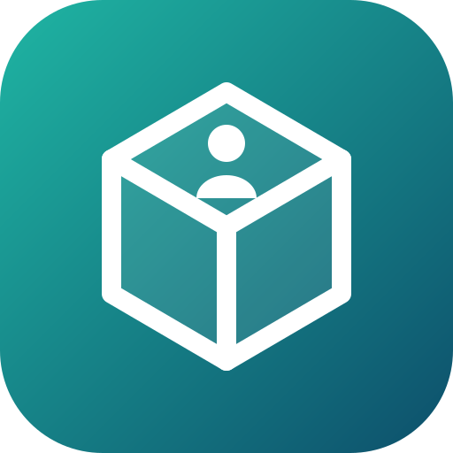
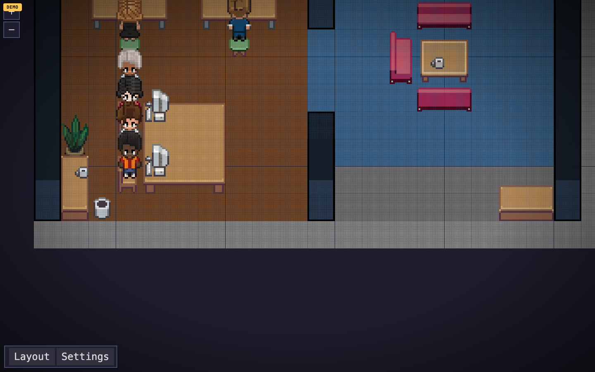
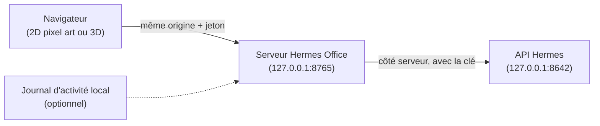
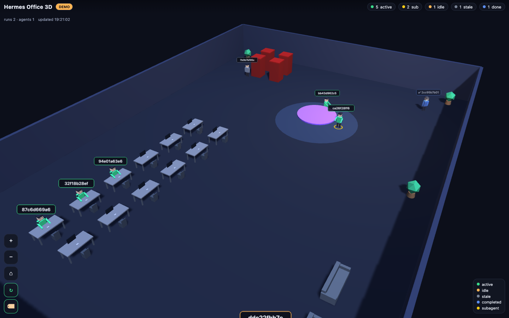
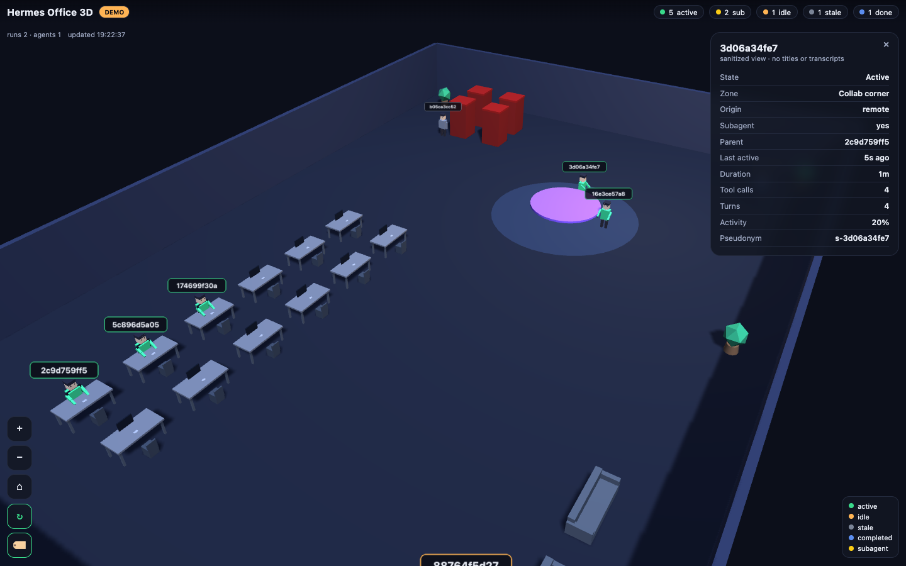
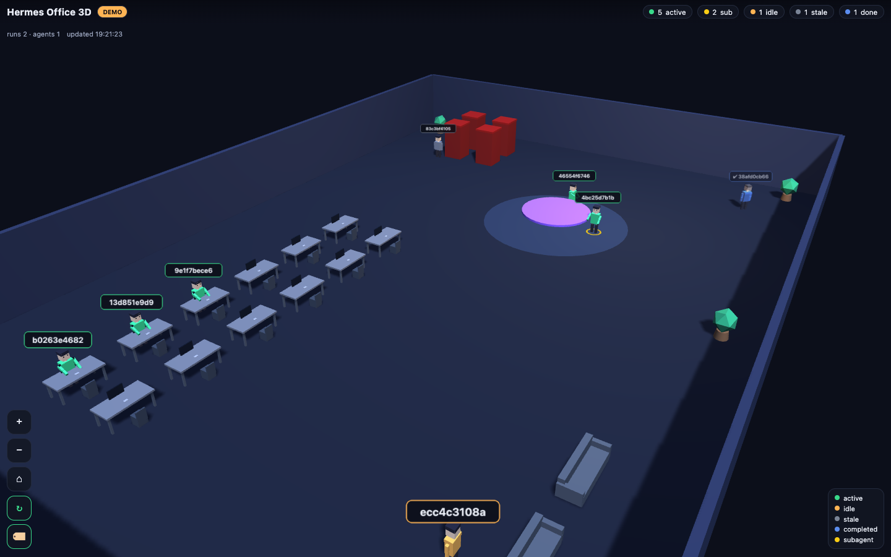
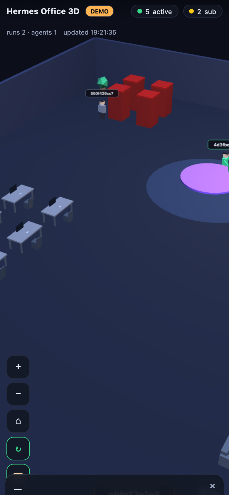

<div align="center">

[](README.en.md)



# Hermes Office 3D

**Un bureau animé qui montre tes sessions Hermes Agent en cours.**<br>
Un personnage par session récente, sous-agents compris. En lecture seule, privé par défaut : le navigateur ne voit jamais tes titres, tes prompts ni ta clé.

[](LICENSE)
[](pyproject.toml)
[](#capture-décran)
[](docs/MOBILE_ACCESS.md)
[](SECURITY.md)

</div>

<p align="center"></p>

<p align="center"><sub>Capture générée par le mode démo (données synthétiques). Aucune session réelle n'apparaît.</sub></p>

## Pourquoi

Quand plusieurs agents Hermes tournent en même temps, il est difficile de voir d'un coup d'œil qui travaille, qui attend et qui a lancé des sous-agents. Hermes Office 3D met tout ça dans un bureau : un personnage par session récente, placé selon son état.

C'est un moniteur, pas un tableau de bord de plus : il ne peut ni envoyer de message, ni lancer d'outil, ni arrêter un run. Il lit l'API Hermes locale côté serveur et ne donne au navigateur qu'un instantané anonymisé.

> **Ce dépôt GitHub ne contient que le code source.** Le cloner ne publie pas ton bureau. Ce qui tourne est un serveur local, protégé par un jeton, sur `127.0.0.1`, que tu lances toi-même.

## Comment ça marche



- **Un seul interlocuteur pour le navigateur.** Il ne parle qu'au serveur du bureau. La clé de l'API Hermes reste dans le processus serveur.
- **Rien d'inventé.** Chaque personnage correspond à une vraie ligne de `GET /api/sessions`. Si l'API est configurée mais injoignable, l'interface le dit et n'affiche rien.
- **Deux vues.** La racine ouvre le bureau en pixel art 2D ([Pixel Agents](NOTICE.md)). L'ancienne vue 3D low-poly reste disponible sur `/office.html`, après connexion.
- **Mode démo.** Sans clé, ou avec `--demo`, le serveur sert des personnages synthétiques (ids `demo-`), jamais mélangés à du réel.

### Ce que signifie un personnage

Un personnage est une **ligne récente et réelle** de `GET /api/sessions`. En mode live, les sessions anciennes ou terminées n'apparaissent pas. Une ligne récente ne prouve pas que la session tourne :

| Affiché | Champ source | Remarques |
| --- | --- | --- |
| un personnage par session récente | `id` | l'id est pseudonymisé côté serveur ; l'interface montre des noms comme `Session 1` |
| `recently active` / `quiet` | `last_active`, `ended_at` | déduit de la récence seule, pas du statut d'exécution |
| `completed` | `ended_at` présent | jamais affiché dans le bureau actif |
| anneau de sous-agent + lien au parent | `parent_session_id`, `is_internal_child` | sessions enfants, demandées avec `include_children=true` |
| appels d'outils / tours | `tool_call_count`, `message_count` | simples compteurs cumulés |
| origine | `source` | regroupée en `local` / `remote` / `agent` |

Le placement par zone (`Workstation`, `Collab corner`, `Lounge`, `Quiet booth`, `Archive`) est un choix de présentation lié à l'état, jamais un fait sur ce que fait la session.

| État | Condition |
| --- | --- |
| `active` | non terminée et `now - last_active ≤ ACTIVE_SECONDS` (120 s par défaut) |
| `idle` | non terminée et `now - last_active ≤ IDLE_SECONDS` (300 s par défaut) |
| `stale` | non terminée et plus ancienne que `IDLE_SECONDS` : masquée |
| `completed` | `ended_at` renseigné : masquée |

Les libellés (`Session 1`, `Subagent 1`) sont des alias locaux stables d'un rafraîchissement à l'autre, pas des noms de session ni des hachages.

### Actif ou seulement récent

L'API de liste des sessions d'Hermes n'expose pas de statut d'exécution par session. Les compteurs globaux (`active_agents`, `active_runs`) disent qu'il y a du travail en cours, mais pas à quelle session il appartient. Une longue commande silencieuse peut avoir un horodatage ancien. Hermes Office n'affiche donc que l'activité récente, ne la présente jamais comme du travail confirmé, et montre les compteurs globaux à part. Si aucune session récente n'est identifiable, le bureau reste vide, même quand la passerelle annonce du travail.

**Observation d'activité réelle (optionnelle, désactivée par défaut).** Si tu définis `HERMES_OFFICE_RUN_ACTIVITY_LOG` vers un journal local écrit par le pont A2A, le serveur lit sa fin, retrouve les runs, et ne marque une session comme `working` que si l'API Runs de Hermes confirme un run en cours pour elle. Avec `HERMES_API_KEY`, il suit alors les évènements d'outils de ces runs et anime le personnage selon une catégorie grossière (`code`, `search`, `terminal`, `review`, `other`). Noms d'outils, arguments, résultats et ids ne sortent jamais. Ça ne couvre que les runs passés par ce pont, pas toutes les conversations.

## Installation

```sh
curl -fsSL https://raw.githubusercontent.com/pyxl-dev/hermes-office-3d/main/install.sh | sh
```

L'installateur met le code dans `~/.local/share/hermes-office-3d` et ajoute la commande `hermes-office-3d` dans `~/.local/bin`. Relance-le pour mettre à jour ; `--uninstall` enlève tout (le jeton `~/.hermes-office-token` reste, supprime-le toi-même si tu veux). Il ne touche qu'à ton dossier perso.

Ensuite, le mode démo, sans secret et sans Hermes :

```sh
hermes-office-3d --demo
```

Ouvre l'adresse affichée et connecte-toi avec le jeton écrit dans `~/.hermes-office-token` (un jeton aléatoire est généré au premier lancement, en mode `0600`, et jamais affiché).

Sans l'installateur :

```sh
git clone https://github.com/pyxl-dev/hermes-office-3d.git
cd hermes-office-3d
python3 -m hermes_office --demo
```

### Mode live (tes vraies sessions)

Depuis le dossier du code (`~/.local/share/hermes-office-3d` avec l'installateur, ou ton clone) :

```sh
cp .env.example .env
# édite .env et renseigne :
#   HERMES_OFFICE_TOKEN=<une longue chaîne aléatoire>
#   HERMES_API_KEY=<ton API_SERVER_KEY Hermes>
# (la clé est dans ~/.hermes/.env sous API_SERVER_KEY : copie-la, ne la commite pas)
make run          # ou : python3 -m hermes_office
```

Le serveur lit automatiquement un `.env` local ; les vraies variables d'environnement l'emportent. Sinon, exporte-les dans ton shell :

```sh
set -a; source .env; set +a
python3 -m hermes_office
```

Ouvre `http://127.0.0.1:8765`, connecte-toi avec ton jeton, et ton bureau live apparaît. Avec l'installateur, `hermes-office-3d` lance la même chose depuis son dossier d'installation, donc il lit le `.env` qui s'y trouve.

### Laisse ton agent IA s'en occuper

Colle ceci dans Claude Code, Codex, Cursor ou n'importe quel agent qui a accès à un terminal :

```text
Installe et lance Hermes Office 3D : https://github.com/pyxl-dev/hermes-office-3d
Suis le fichier AGENTS.md de ce dépôt.
```

[`AGENTS.md`](AGENTS.md) explique à l'agent comment l'installer, comment le lancer et les règles de sécurité (ne jamais exposer l'API Hermes, ne jamais afficher le jeton). Il est en anglais, la langue que tous les agents lisent.

### Prérequis

| | Sert à |
| --- | --- |
| macOS ou Linux | tout |
| Python 3.9 ou plus | le serveur (bibliothèque standard seule, rien à `pip install`) |
| git | l'installateur |
| Une API Hermes locale et sa clé | le mode live ; sans elle, mode démo |
| [Tailscale](https://tailscale.com) sur la machine et le téléphone | voir le bureau depuis le téléphone (optionnel) |

## Utilisation

```sh
hermes-office-3d [--host HOST] [--port N] [--demo] [--verbose]
```

| Option | Par défaut | |
| --- | --- | --- |
| `--host HOST` | `127.0.0.1` | adresse d'écoute |
| `--port N` | `8765` | port d'écoute |
| `--demo` | non | force les données synthétiques, même avec une clé |
| `--verbose` | non | journaux de debug |

Toute la configuration passe par des variables d'environnement (voir [`.env.example`](.env.example)). Aucune valeur personnelle n'est codée en dur.

| Variable | Par défaut | |
| --- | --- | --- |
| `HERMES_OFFICE_HOST`, `HERMES_OFFICE_PORT` | `127.0.0.1`, `8765` | où le serveur écoute |
| `HERMES_OFFICE_ALLOW_REMOTE` | `0` | une adresse non locale est refusée sans `1` ; ne le fais que derrière un accès authentifié |
| `HERMES_OFFICE_TOKEN` | généré | jeton qui protège toutes les routes (lettres, chiffres, `-_.`) |
| `HERMES_API_BASE` | `http://127.0.0.1:8642` | API Hermes locale |
| `HERMES_API_KEY` | vide | clé `API_SERVER_KEY` ; vide = mode démo |
| `HERMES_OFFICE_POLL_SECONDS` | `4` | fréquence de rafraîchissement |
| `HERMES_OFFICE_ACTIVE_SECONDS`, `HERMES_OFFICE_IDLE_SECONDS` | `120`, `300` | seuils de récence |
| `HERMES_OFFICE_MAX_ACTORS` | `48` | nombre maximal de personnages |
| `HERMES_OFFICE_RUN_ACTIVITY_LOG` | vide | journal d'activité local (observation optionnelle) |

### Voir le bureau sur ton téléphone

L'accès distant est désactivé par défaut. Le chemin recommandé est `tailscale serve`, qui publie uniquement ce port sur ton réseau privé Tailscale :

```sh
tailscale serve --bg --https=443 http://127.0.0.1:8765
```

Ouvre l'URL `https://<machine>.<ton-tailnet>.ts.net/` sur le téléphone et connecte-toi avec le jeton. Détails, vérifications et alternatives dans [`docs/MOBILE_ACCESS.md`](docs/MOBILE_ACCESS.md). N'expose jamais `127.0.0.1:8642`, et jamais le bureau sans son jeton.

## Sécurité

Lis [`SECURITY.md`](SECURITY.md) et [`docs/PRIVACY.md`](docs/PRIVACY.md). En bref :

- écoute sur `127.0.0.1` par défaut, jamais sur une interface publique ;
- **toutes** les routes (interface, `/api/office`, `/events`) exigent un jeton ou un cookie `HttpOnly; SameSite=Strict` : il n'y a pas de bureau anonyme ;
- le navigateur n'atteint jamais l'API Hermes, la clé reste côté serveur ;
- CSP stricte, `X-Frame-Options: DENY`, `nosniff`, pas de CORS ;
- la charge utile vient d'une liste blanche, et les ids sont pseudonymisés avec un sel aléatoire par exécution.

Jamais envoyés au navigateur : `title`, `preview`, `system_prompt`, contenu des messages, `user_id`, nom du modèle, `source` brute, chemins, coûts, clé de l'API Hermes, id de session brut.

## Limites

- Les **sous-agents** n'apparaissent que si ta version de Hermes enregistre les sessions enfants (`parent_session_id` / `is_internal_child`). Sinon il n'y en a pas, on ne les invente pas.
- Le **statut d'exécution par session** n'est pas exposé par l'API de liste. Voir « Actif ou seulement récent » pour l'observation optionnelle.
- Les compteurs d'outils et de messages sont cumulés, pas une progression en direct.
- Le bureau affiche au plus `MAX_ACTORS` sessions (48 par défaut) : c'est un moniteur, pas un navigateur de sessions.
- `GET /v1/runs` ne se liste pas : le détail des runs actifs n'est pas disponible, le nombre agrégé vient de `GET /health/detailed`.

## Capture d'écran

Toutes les images viennent du mode **démo** (données synthétiques, badge `DEMO` visible). Aucune donnée de session réelle.

| Vue 3D, bureau (1440×900) | Vue 3D, panneau de détails (anonymisé) |
| --- | --- |
|  |  |

| Vue 3D, autre angle | Vue 3D, mobile (390×844) |
| --- | --- |
|  |  |

## Pourquoi cette base

Deux projets open source ont été étudiés :

| Projet | Licence | Verdict |
| --- | --- | --- |
| [VirtOffice](https://github.com/OneByJorah/VirtOffice) | MIT | **Retenu.** Serveur Python sans dépendance et bureau Three.js en un fichier, avec avatars animés et zones. Son « intégration » Hermes interroge un `/api/agents/status` qu'Hermes n'expose pas et invente `mood`/`tasksDone`/`hours`. On garde le style (avatars, zones) et on remplace la couche de données par un adaptateur honnête, qui n'observe que le réel. |
| [Hermes3D](https://github.com/iamlukethedev/Hermes3D) | MIT | Écarté. Next.js 16, React Three Fiber, Phaser, proxy WebSocket Node, Spotify et voix : bien plus de surface qu'un moniteur en lecture seule n'en demande. Aucun code repris. |

La vue 2D vient du moteur de rendu [Pixel Agents](https://github.com/pixel-agents-hq/pixel-agents), embarqué dans `pixel-client/`. Attributions complètes dans [`NOTICE.md`](NOTICE.md).

## Développement

```sh
git clone https://github.com/pyxl-dev/hermes-office-3d.git && cd hermes-office-3d
make demo                       # serveur de démo
python3 -m pytest tests -q      # tests (pip install pytest)
python3 scripts/smoke.py        # démarre la démo et l'interroge en HTTP
make check                      # ce que lance la CI
```

Les tests couvrent l'adaptation d'état, la rédaction et la pseudonymisation, la liste blanche de la charge utile (avec un test de fuite sur une session titrée), le plafond de personnages et les frontières HTTP (jeton sur chaque route, connexion par cookie, en-têtes de sécurité, pas de CORS, rejet des traversées de chemin).

La vue 2D est déjà compilée dans `web/pixel`. Pour la modifier, travaille dans `pixel-client/` (`npm install`, puis `npm run build`, qui écrit dans `web/pixel`).

| Fichier | |
| --- | --- |
| `hermes_office/` | serveur standard, adaptateur, rédaction, modèle d'état, observation d'activité |
| `web/` | l'interface : `office.html` et `app.js` (3D), `vendor/three.min.js`, `pixel/` (2D compilée) |
| `pixel-client/` | sources de la vue 2D (Pixel Agents), compilées vers `web/pixel` |
| `tests/` | suite pytest |
| `scripts/smoke.py` | test de fumée HTTP |
| `docs/` | vie privée, accès mobile, captures, logo |
| `.env.example` | configuration d'exemple |
| `AGENTS.md` | instructions pour n'importe quel agent IA |
| `install.sh` | installateur |

## Licence

[MIT](LICENSE). Attributions tierces dans [`NOTICE.md`](NOTICE.md).
